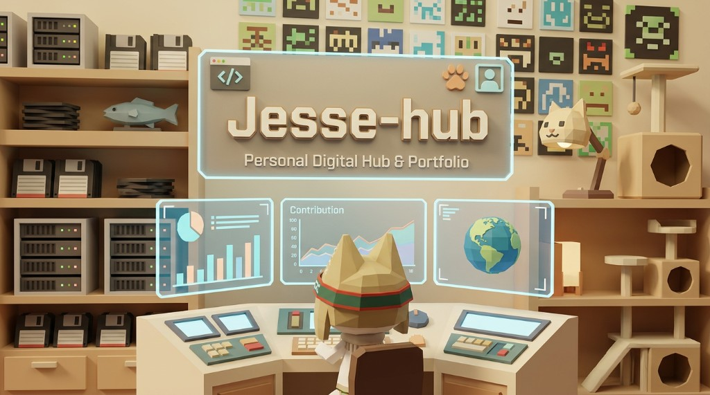

# Jesse-hub

> 一个给 Jesse 的个人数字空间：把正在思考的事、正在做的作品，和一点点不安分的好奇心放在同一个地方。

## 这里有什么

Jesse-hub 不是一张把关键词排满的名片，更像一间可以慢慢逛的工作室。

- **Home**：从一句 “Hi, I’m Jesse” 开始，点击、拖拽和碰撞都会让入口页有一点回应。
- **Moment**：创意作品的陈列室，收录视觉实验、品牌练习、3D 探索和一些正在生长的想法。
- **Project**：项目档案，记录我在 AI Agent、软件测试、FDE、独立游戏等方向上的实践。
- **Me**：关于我正在相信的事——热情、长期主义、复盘，以及让人继续向前的爱。

## 关于 Jesse

我喜欢把 AI 从“概念”推向真实可用的东西，也在摸索 AI-native 到底应该是什么样子。好奇心让我不断靠近陌生问题：软件测试与测试开发、AI Agent、FDE，以及业余时间做的独立游戏。

工作之外，我会唱歌、听音乐、去旅行。代码是我的工具，持续学习是我的习惯，认真生活则是这座小空间的底色。

## 逛逛 / 联系

- [GitHub](https://github.com/Jesseovo)
- [在线访问 Jesse-hub](https://github.com/Jesseovo/Jesseovo-hub)
- Gmail：Jesseovo1219@gmail.com
- QQ Mail：2953825993@qq.com
- WeChat：CHITING0_0

如果你也在研究“怎么把想法做出来”，欢迎来打个招呼。这里没有标准答案，只有一些还在迭代中的答案。

Built with curiosity · kept alive by persistence

